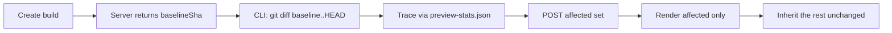

Affected capture is StoryShelf's answer to Chromatic's TurboSnap: instead of rendering every story on every build, the server renders only the stories downstream of your change and inherits the rest unchanged from their baselines. It is **on by default** and fails open — anything it cannot prove unchanged gets rendered.

## How it works



1. **Ancestor.** `POST /api/v1/projects/:slug/builds` returns `baselineSha`: the latest prior revision on the same branch with a build (`null` for first builds).
2. **Changed files.** The CLI diffs `baselineSha..HEAD` (plus staged and untracked files) to get the change list, relative to the repository root.
3. **Trace.** The change list is traced through the bundler dependency graph (`preview-stats.json` in the built Storybook) down to story files. New stories — files with no baseline — always render regardless of the trace.
4. **Record.** The CLI posts `{ baselineSha, changedFiles, affectedImportPaths }` to `POST …/builds/:id/affected` before uploading the bundle, so the computation is auditable on the build row.
5. **Partition.** The orchestrator splits discovered stories into render vs inherit sets, renders only the affected ones, and creates `unchanged` snapshots for the rest that reuse the baseline screenshot (`inherited: true`). Counts include inherited snapshots; `changedCount` excludes them. The build stores how many it inherited as `inheritedCount`.

## The inherited share

The builds page shows **Average inherited share per build** for a project with `testing` on: for each of the project's newest 20 builds that hold snapshots, the share of its snapshots that was inherited rather than captured (`inheritedCount / snapshotCount`), averaged over those builds with every build weighing the same, whatever its status. It says how much capture the baselines saved you from re-doing. It is a count of snapshots, not a measure of time or cost: an inherited snapshot costs nothing to produce, but the stories you do render differ widely in how long they take, so the percentage is no estimate of the time or compute saved. The card is hidden until a build has snapshots.

## Storybook in a monorepo package

Git reports changed files relative to the repository root, while the bundler's module ids and the story index are relative to the Storybook project. When Storybook lives in a package (`packages/app`, an Nx or Turborepo workspace), StoryShelf resolves both to absolute paths before comparing them, so a change to `packages/app/src/ui/kbd.tsx` finds the stories that import `./src/ui/kbd.tsx`. A change in a sibling workspace package (`packages/core/src/x.ts`, which the stats call `../core/src/x.ts`) finds its importers the same way.

- **Run `storyshelf upload` from the Storybook package** (the directory holding `.storybook/`), the same place you build it. The repository root is found from there with `git`. From the repository root with `--build-dir packages/app/storybook-static`, module ids would be read against the wrong directory.
- A change that touches nothing in the graph (the root `README.md`, a docs-only or test-only change) legitimately affects no story: the upload is selective and `fullReason` stays empty. There is no "nothing matched, so render everything" guess; the `path-base-unknown` reason covers the one case where the paths cannot be anchored at all.
- Story paths on the build stay relative to the Storybook project, as before.

## Opting out

| Method                                                  | Effect                                                         |
| ------------------------------------------------------- | -------------------------------------------------------------- |
| `storyshelf upload --full`                              | Render every story for this upload                             |
| `STORYSHELF_FULL=1`                                     | Same, via env (useful for release pipelines)                   |
| `"affectedOnly": false` in `.storybook/storyshelf.json` | Disable for the project (see [Configuration](/guides/config/)) |

## Skipping unchanged commits

Opt in with `storyshelf upload --skip-unchanged` (`"skipUnchanged": true`, or `STORYSHELF_SKIP_UNCHANGED=1`). When a commit reaches **no** story, the CLI records a `skipped` build instead of uploading the Storybook: no upload, no capture, no snapshots. The commit still gets a status, because a pull request that requires the check would otherwise wait forever.

**What is compared.** The CLI asks the server for the newest earlier build on the same branch, then traces `git diff <that build's commit>..HEAD` as above. Only an empty affected set skips, and the skipped build repeats the outcome of that build.

**When it won't skip.** The CLI uploads normally, and prints why, when:

- there is no earlier build on the branch. The first build on a branch is always a real build: the comparison would be against another branch, and "nothing changed since the merge base" is not a claim Shelf can make truthfully;
- the earlier build is not `approved` (open for review, rejected, failed, cancelled or still running), because skipping would turn an open or failing check green;
- the trace needs a full render (shallow clone, global file change, missing stats) or any story is affected;
- a story was added, renamed or removed since that build: the CLI sends the new Storybook's entry ids and the server refuses unless they equal that build's, so every such change uploads;
- `--full` is set;
- the server runs without testing, runs Storybook tests for the project, has skipped builds off, refuses the request, or any call fails.

**Labels and retries.** `--label` values (including `persistent`) are attached to the skipped build as they are to a normal one. The CLI sends one idempotency key per run: after a network failure it retries up to three times with the same key, and the server returns the build the first request already created.

**It follows its source.** If the source build's verdict later changes, the skipped build's status follows it.

## Build identity: sha and branch without git

`upload` resolves each field independently — **flags > env > local git > synthesized** (`local-<random>` sha on the `local` branch). A project with no git at all uploads with zero identity flags; those builds always render everything (`not-a-git-repo` below). The full story — synthetic identity, environments as branches, checkout-less pipelines — lives in [Uploading without git](/guides/without-git/).

## Full-render fallbacks

Affected capture never fails an upload. When it cannot prove a story unchanged, it renders everything and prints the reason:

| Reason                         | Meaning                                                                                                      |
| ------------------------------ | ------------------------------------------------------------------------------------------------------------ |
| `shallow-clone`                | No git history (`actions/checkout` needs `fetch-depth: 0`)                                                   |
| `not-a-git-repo`               | No git repository — upload used a synthetic local identity                                                   |
| `dependency-graph-unavailable` | No usable `preview-stats.json` in the built Storybook                                                        |
| `story-index-unreadable`       | No `index.json`/`stories.json` to map stories to files                                                       |
| `global-file-changed`          | A change touches `preview.*`, `manager.*`, `.storybook/main.*`, or a lockfile — these can affect every story |
| `path-base-unknown`            | The repository root, or where the Storybook project sits inside it, could not be determined                  |
| `too-many-changed-files`       | Change list exceeds 10,000 files (large merges, vendored drops)                                              |
| First build                    | No baseline revision exists yet (`baselineSha: null`)                                                        |

Typical CLI output:

```bash
Affected capture: rendering 3 stories (baseline abc1234)
# or
Affected capture: no stories affected (baseline abc1234)
# or
Full capture (shallow-clone): rendering all stories
```

## Tuning the trace

**Untraced files.** Files that appear in the graph but cannot meaningfully change rendering (generated clients, mock data, docs) can be excluded so touching them doesn't re-render their dependents:

```bash
storyshelf upload --untraced "**/*.generated.ts" --untraced "**/mocks/**"
```

For project-wide exclusions that apply to every upload, commit them once in `.storybook/storyshelf.json` instead of repeating flags (see [Configuration](/guides/config/)):

```json
{ "slug": "my-design-system", "untraced": ["**/*.generated.ts"] }
```

Config and flag globs are combined (union, deduplicated). A glob matches a changed file written relative to the Storybook project (what you write next to `.storybook/`, such as `src/generated/**`) and also relative to the repository root (`packages/app/src/generated/**`), so configs written for either keep working. Untraced files are dropped _before_ tracing — stories reachable only through them are inherited. Stories reachable through another (traced) changed file still render.

**Stats when the CLI builds.** When `upload` (or `build`) runs the build script itself and affected capture is on, the CLI appends `--stats-json` to it, so you get the stats file without asking. A custom `buildCommand` is never changed: add `--stats-json` to it yourself, or the CLI prints one warning after the build and the upload renders everything. For a script that rejects the flag, set `"buildStats": false` (or pass `--no-build-stats`).

**Custom stats file.** The graph is read from `<buildDir>/preview-stats.json` by default (written by `storybook build --stats-json`; without that flag the file does not exist and every upload renders everything). Override per run:

```bash
storyshelf upload --stats-file ./stats/preview-stats.json
```

**Diagnose.** `storyshelf doctor` reports affected-capture readiness, including the Storybook project directory and the repository root it will use: shallow clones, missing stats and an unplaceable project produce warnings (not failures).

## What you see in the UI

- The build page shows an `affected capture` badge (or `full capture` when opted out) plus `N rendered, M inherited` counts, and an **Inherited** stat next to the other counts. The numbers are the ones stored on the build (`snapshotCount`, `inheritedCount`), also served by the API.
- The project's **Builds** page shows **Average inherited share per build**; [what it averages and what it does not measure](#the-inherited-share). A high number means affected capture is skipping most of your Storybook; a number near zero means most changes reach most stories (a shared import, for example), and [the trace](#tuning-the-trace) is worth a look.
- Inherited snapshots carry an `inherited` badge and `unchanged` status — they need no review.
- Capture attempt logs include an `affected capture partitioned` line with `{ rendered, inherited, total }`.

## Differences from TurboSnap

Same shape (ancestor → diff → graph trace → selective render), different economics and scope:

- **No billed snapshots** — skipping saves your server's CPU, not money. There is no 0.2× copy charge because there is no billing at all.
- **Vite stats only** — the trace reads `preview-stats.json` (plus tolerant Webpack-reasons shapes). Custom builders without stats fall back to full renders.
- **Server verifies** — the orchestrator re-partitions from the stored payload and only inherits stories with a resolvable baseline, so a stale or forged list can only over-render, never under-test.

## Related

- [Uploading without git](/guides/without-git/) — synthetic identity and non-git workflows
- [Capture & viewports](/concepts/capture/) — the render pipeline
- [Builds & snapshots](/concepts/builds/) — the `inherited` flag
- [Configuration](/guides/config/) — `affectedOnly` and precedence
- [CI setup](/guides/ci/) — `fetch-depth: 0` and upload flags
- Package: `@storyshelf/affected` (dependency tracing library)
