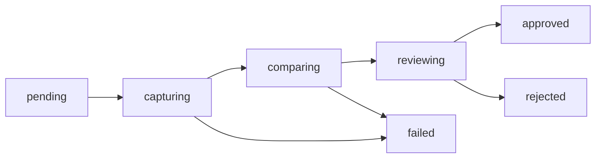

import Screenshot from "../../../components/Screenshot.astro";

A **build** is one upload of a Storybook (one `POST /api/v1/projects/:slug/builds` + zip `PUT`). A **snapshot** is one screenshot for one `story × viewport` inside that build. A project holds many builds; each build holds many snapshots.

<Screenshot
  name="build-review"
  alt="A build's overview: snapshot stats, bulk actions, and a card per snapshot"
/>

## Lifecycle



| Status                  | Meaning                            |
| ----------------------- | ---------------------------------- |
| `pending`               | Uploaded, queued                   |
| `capturing`             | Playwright/Puppeteer rendering     |
| `comparing`             | Diffing against baselines          |
| `reviewing`             | Diffs ready, needs human review    |
| `approved` / `rejected` | Review complete                    |
| `failed`                | Capture or `play` threw (blocking) |

Default-branch builds auto-approve and write baselines; feature-branch builds land in `reviewing`.

Without `testing` nothing is captured: a published default-branch build becomes `approved` when publishing ends and is labelled **Published** on its page, which shows component and story counts from the [catalog](/concepts/publishing/#the-catalog-and-the-pages-it-feeds) instead of snapshot counts.

A build on another branch is accepted the same way when the project has **review off** (`reviewEnabled: false`). With review on (the default) it stays `pending` until reviewers decide it with a **build-level verdict** (`POST /api/v1/projects/:slug/builds/:id/reviews`, approver and admin): `approved` once the project's required approvals (`reviewApprovals`, default 1) are present and no reviewer's latest verdict is `rejected`, `rejected` when any is. A verdict is rewritable and belongs to its build, so a new push needs a new approval. With `testing` on the snapshot rollup decides and a verdict is only a sign-off. The build page lists what the build changed in the catalog (components added, removed and changed against the latest accepted build of the branch, else of the default branch), the verdicts, and the build and story comments. A `pending` build that nobody reviews is [purged](/concepts/retention/#pending-builds) once its last activity is older than the retention window. See [Review](/guides/review/#review-without-screenshots).

**Snapshots** track the diff result:

| Status                  | Meaning                                                                |
| ----------------------- | ---------------------------------------------------------------------- |
| `pending`               | Not yet rendered                                                       |
| `new`                   | No baseline on this branch or default — needs accept                   |
| `changed`               | Diff ratio exceeds `maxDiffRatio` / pixel threshold                    |
| `unchanged`             | Within threshold — auto-approved (includes baseline-inherited stories) |
| `approved` / `rejected` | Human decision                                                         |

`storyId` is `components-button--primary` (unique), plus `storyName`, `storyTitle`, and `viewportName` (`desktop` default `1280×720`). `diffPixels` / `diffRatio` / `diffPath` are populated only when a baseline exists.

With [affected capture](/concepts/affected-capture/), stories outside the change inherit their baseline without rendering: snapshots with `inherited: true` reuse the baseline screenshot and land `unchanged`. The build row records the computation (`affectedOnly`, `baselineSha`, `changedFiles`, `affectedImportPaths`; `null` paths mean a full render).

## Attempts & logs

Each capture run records a `captureAttempts` row (attempt `1`, `2` on retry) and streams structured logs to `captureLogs`. Inspect per-attempt history:

- `GET /api/v1/projects/:slug/builds/:id/attempts`
- `GET /api/v1/projects/:slug/builds/:id/attempts/:no/logs`

A render no longer goes quiet between "partitioned" and "stories rendered". For each browser engine the attempt log records, in order:

- `affected capture partitioned`: how many stories render and how many inherit a baseline.
- The runner's own `info`, `warn` and `error` lines: `capture sizing` (detected CPUs and memory, pages at once, timeout), `browser recycled`, `a11y violations found` (one line per story with the axe rule ids; non-blocking, the texts are also kept on the snapshot and shown in review) and `render failed for story`. Debug lines stay in the server log only.
- `captured N/M screenshots` after every 10 screenshots (it counts story and viewport pairs, so a story with several viewports or modes counts several times).
- `render pass finished` with the captured, failed and expected counts.

Progress lines appear only for runners that stream captures (the bundled Playwright and Puppeteer runners do). Lines are written one at a time, so their order is stable even when several pages fail at once.

Retry a flaky capture with `POST …/builds/:id/retry` or `storyshelf retry --build-id`.

Stop a build that is `pending`, `capturing` or `comparing` with **Cancel build** on the build page or `POST /api/v1/projects/:slug/builds/:id/cancel` (developer role and above, needs `testing`). Every queued job of the build (capture, publish and notification jobs) is cancelled, a running capture stops within a few seconds, and the build ends `failed`, so git statuses, webhooks and notifications report an ordinary failure; there is no separate cancelled status. Retry it later like any failed build. A build in any other state answers `409`.

## What outlives a build

Builds and snapshots are transient — purged after `purgeTtlDays` (see [Retention](/concepts/retention/)). Baselines are the truth and survive purge. A build bearing a `persistent` label (git tag, e.g. `v1.2.3`) is never purged; see [Baselines & branches](/concepts/baselines/) and [Labels](/concepts/labels/).

Find builds by branch/status/label:

```sh
curl "$SHELF/api/v1/projects/my-app/builds?branch=main&status=reviewing"
curl "$SHELF/api/v1/projects/my-app/builds?label_key=pr&label_value=42"
```

Stable label URLs (`/projects/:slug/labels/:key/:value`) always resolve to the latest build for that value.

## Related

- [Baselines & branches](/concepts/baselines/) — which screenshot is the expected one
- [Labels](/concepts/labels/) — typed values for search and stable URLs
- [Review workflow](/guides/review/) — approve/reject, comments, retry
- [Retention](/concepts/retention/) — what survives purge
