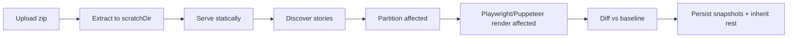

import Screenshot from "../../../components/Screenshot.astro";

Capture is server-side. The CLI uploads a zipped static Storybook; the server extracts it, serves it locally, and screenshots the stories impacted by the change — unaffected stories are inherited from their baselines (see [Affected capture](/concepts/affected-capture/)).

<Screenshot
  name="build-review"
  alt="A build's overview: snapshot stats, bulk actions, and a card per snapshot"
/>

## Pipeline



The **orchestrator** (`core/capture/orchestrator.ts`) owns loading, extraction (`scratchDir`), discovery (`StorySourceAdapter`), affected partitioning, and persistence. The **CaptureRunner** is pure — it only returns PNG buffers. Sources expose an optional `loadDependencyGraph` hook so the orchestrator can trace changes; sources without one render everything.

```ts
interface CaptureRunner {
  render(input: {
    buildId;
    storybookDir;
    stories;
    viewports;
    browser?;
    executePlay?;
    playTimeoutMs?;
  }): Promise<RenderResult>;
  cancel(buildId): Promise<void>;
}
```

Two runners ship — switch with one import:

| Runner     | Package                         | Engines                                                           |
| ---------- | ------------------------------- | ----------------------------------------------------------------- |
| Playwright | `@storyshelf/runner-playwright` | `chromium` (default), `firefox`, `webkit`, `chrome`               |
| Puppeteer  | `@storyshelf/runner-puppeteer`  | `chromium`/`chrome` only, `chrome-headless-shell` — smaller image |

Per-project engine lives in **Settings → General → Capture browser** or `PATCH /api/v1/projects/:slug { browser }`. Set `browsers` (up to 3, primary first) to capture every build on each engine in turn; baselines, diffs and storage paths are kept per engine (`<mode>~<browser>` for non-Chromium). Every snapshot records `infraHash = hash(browser + viewport + sizing defaults)`. A newly added engine has no baselines yet, so its first snapshots are auto-accepted where the primary engine's snapshot of the same story and mode is clean, and queued for review as `new` otherwise.

## Viewports & sizing

Global viewports live in `ShelfConfig.viewports` (or project settings). Per-story `parameters.viewport` adds to the union (deduped by name). The runner auto-crops small components (≈60% whitespace) with 16px padding and clamp (`minWidth`/`maxWidth` etc.), and falls back to `fullPage` on overflow — see `core/capture/sizing.ts`.

Configure via server config or project patch. The queue then fans out `stories × viewports` renders at `capture.concurrency`.

## Capturing in a child process

By default the server renders in its own process, so a browser crash or a runaway capture shares a process with the web UI. Set `capture.workerEntry` to run captures in a forked child instead:

```ts
// capture-worker.ts — the module named by capture.workerEntry
import { runCaptureChild } from "@storyshelf/worker";

await runCaptureChild({ db: database, storage, runner, scratchDir });
```

```ts
const app = createShelfApp({
  database,
  storage,
  capture: { runner, workerEntry: new URL("./capture-worker.ts", import.meta.url).pathname },
});
```

The server keeps the queue and its status; the child pulls jobs over IPC and shares the server's database and storage. If the child crashes, its in-flight jobs are requeued and the child restarts; a job that crashes it repeatedly is failed. After repeated crashes (3 in 5 minutes) or a failed fork, capture falls back to the in-process queue. A child that hangs without dying is caught too: the child reports progress as a capture logs, and if a running job goes 10 minutes without any, the server kills the child and treats it like a crash (the job is redelivered, and fails if it keeps hanging the child).

`capture.mode` controls this: `auto` (default) forks only when `workerEntry` is set and the host has at least 2 CPUs and 2 GB; `in-process` never forks; `fork` always forks and fails at boot if it cannot. `capture.runner` is still required, since it serves the fallback. `SIGTERM` lets the child finish its current captures; if the server disappears, the child exits at once.

## Content-addressed storage

Published Storybooks are deduplicated by content hash. `persistStorybookStatics` (`core/capture/statics.ts`) `sha256`s every file, writes once to `content/<hash>` (`storage.write(content/<hash>, buffer)` if missing), upserts `content_refs { hash, refCount, lastSeenAt }` via `db.tables.contentRefs` (type-safe `DatabaseAdapter.tables`, no `as never`), and writes a per-build `manifest.json` (`{ "assets/index.js": "abc..." }`). Serving prefers `manifest.json` → `content/<hash>` with `readWithManifestFallback`, falling back to the legacy per-build copy during migration. Uploads use the same dedup: `POST /dedup { hashes }` → `needed`, batch `POST /content` (multipart, `80%` bytes fallback `neededBytes/totalBytes > 0.8` → `PUT zip`), then `POST /manifest` — see [Publishing](/concepts/publishing/) and ADR 0020.

## Diffing

`pixelmatch` + `pngjs` compare against the selected baseline (see [Baselines](/concepts/baselines/)). Per-pixel `pixelThreshold` (default 0.1) and per-snapshot `maxDiffRatio` (default 0.01) decide `changed` vs `unchanged`; per-story `parameters.diffThreshold` (or `chromatic.diffThreshold` with `storyshelf` winning) overrides. Overlay is stored at `diffs/{storyId}/{viewport}.png` — 50% dim + red heatmap.

## Interaction testing hook

When **Enable interaction tests (play)** is on (per-project), the runner does `waitForSelector(#storybook-root, attached)` → `waitForTimeout(delay ?? 500)` → `page.evaluate(executePlay)` with `playTimeoutMs` before the screenshot. A throwing `play` maps to `failed` (blocking) or warning (flaky) — see [Interaction testing guide](/guides/interaction-testing/).

## Restarts during a capture

With the in-process queue, a server restart can interrupt a build that is `capturing`. On startup StoryShelf requeues each such build **once**: the interrupted attempt is recorded as failed (`Interrupted by server restart`) and the build returns to `pending`. If that run is interrupted too, the build is marked `failed` and its git status reports failure, so a crash loop never repeats captures. The Compute jobs page flags interrupted builds and lets you retry them. Remote queues are not affected: the queue redelivers the message after its visibility timeout.

## Remote capture

On serverless (Vercel, Lambda, Workers) the API enqueues `CaptureQueue.enqueue({ buildId })` and a separate `@storyshelf/worker` polls (`SQS`, `Redis`, `Azure`) and runs the same orchestrator — see [Cloud assembly](/guides/deployment/cloud/).

## Related

- [Affected capture](/concepts/affected-capture/) — render only impacted stories
- [Projects](/concepts/projects/) — slug, `git_default_branch`, thresholds
- [Builds & snapshots](/concepts/builds/) — statuses
- [Retention](/concepts/retention/) — what survives
- Packages: [runner-playwright](/packages/runner-playwright/), [runner-puppeteer](/packages/runner-puppeteer/), [worker](/packages/worker/)
