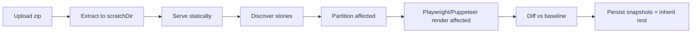

import Screenshot from "../../../components/Screenshot.astro";

Capture is server-side. The CLI uploads a zipped static Storybook; the server extracts it, serves it locally, and screenshots the stories impacted by the change — unaffected stories are inherited from their baselines (see [Affected capture](/concepts/affected-capture/)).

<Screenshot
  name="build-review"
  alt="A build's overview: snapshot stats, bulk actions, and a card per snapshot"
/>

## Pipeline



The **orchestrator** (`core/capture/orchestrator.ts`) owns loading, extraction (`scratchDir`), discovery (`StorySourceAdapter`), affected partitioning, and persistence. The **CaptureRunner** is pure — it only returns PNG buffers. Sources expose an optional `loadDependencyGraph` hook so the orchestrator can trace changes; sources without one render everything.

```ts
interface CaptureRunner {
  render(input: {
    buildId;
    storybookDir;
    stories;
    viewports;
    browser?;
    executePlay?;
    playTimeoutMs?;
  }): Promise<RenderResult>;
  cancel(buildId, runId?): Promise<void>; // one render (a shard), or all of the build
}
```

Two runners ship — switch with one import:

| Runner     | Package                         | Engines                                                           |
| ---------- | ------------------------------- | ----------------------------------------------------------------- |
| Playwright | `@storyshelf/runner-playwright` | `chromium` (default), `firefox`, `webkit`, `chrome`               |
| Puppeteer  | `@storyshelf/runner-puppeteer`  | `chromium`/`chrome` only, `chrome-headless-shell` — smaller image |

Per-project engine lives in **Settings → General → Capture browser** or `PATCH /api/v1/projects/:slug { browser }`. Set `browsers` (up to 3, primary first) to capture every build on each engine in turn; baselines, diffs and storage paths are kept per engine (`<mode>~<browser>` for non-Chromium). Every snapshot records an `infraHash`: a hash of its **capture fingerprint** (engine, browser build, host platform, device scale factor, installed fonts, viewport and sizing defaults), with the components kept on the baseline so a change can be named. When the fingerprint differs from the baseline's (a browser upgrade, a different base image, new fonts), the same code would render differently, so StoryShelf does not diff: the snapshot is accepted as an **environment migration**, the review page says what changed, and on the default branch the baseline is updated to the new rendering. A baseline recorded before fingerprints is compared normally and given its fingerprint on the next default-branch capture. A real regression in the same build as an environment change is not caught, so upgrade the browser in its own commit. A newly added engine has no baselines yet, so its first snapshots are auto-accepted where the primary engine's snapshot of the same story and mode is clean, and queued for review as `new` otherwise.

## Viewports & sizing

Global viewports live in `ShelfConfig.viewports` (or project settings). Per-story `parameters.viewport` adds to the union (deduped by name). The runner auto-crops small components (≈60% whitespace) with 16px padding and clamp (`minWidth`/`maxWidth` etc.), and falls back to `fullPage` on overflow — see `core/capture/sizing.ts`.

Configure via server config or project patch. The queue then fans out `stories × viewports` renders at `capture.concurrency`.

## Capturing in a child process

By default the server renders in its own process, so a browser crash or a runaway capture shares a process with the web UI. Set `capture.workerEntry` to run captures in a forked child instead:

```ts
// capture-worker.ts — the module named by capture.workerEntry
import { runCaptureChild } from "@storyshelf/worker";

await runCaptureChild({ db: database, storage, runner, scratchDir });
```

```ts
const app = createShelfApp({
  database,
  storage,
  capture: { runner, workerEntry: new URL("./capture-worker.ts", import.meta.url).pathname },
});
```

The server keeps the queue and its status; the child pulls jobs over IPC and shares the server's database and storage. If the child crashes, its in-flight jobs are requeued and the child restarts; a job that crashes it repeatedly is failed. After repeated crashes (3 in 5 minutes) or a failed fork, capture falls back to the in-process queue. A child that hangs without dying is caught too: the child reports progress as a capture logs, and if a running job goes 10 minutes without any, the server kills the child and treats it like a crash (the job is redelivered, and fails if it keeps hanging the child).

`capture.mode` controls this: `auto` (default) forks only when `workerEntry` is set and the host has at least 2 CPUs and 2 GB; `in-process` never forks; `fork` always forks and fails at boot if it cannot. `capture.runner` is still required, since it serves the fallback. `SIGTERM` lets the child finish its current captures; if the server disappears, the child exits at once.

## Sharding big builds

A build with thousands of captures does not have to render in one job. Set `capture.shardSize` (in-process server) or `shardSize` (`createCaptureWorker`) to the number of captures (story × viewport × browser engine) one shard should hold:

```ts
createShelfApp({ ..., capture: { runner, shardSize: 500 } });
```

The build's own job becomes a **plan**: it decides what to render, records the shards in `capture_shards` and puts one queue job per shard on the queue. Any worker can take a shard; the one that finishes the last shard claims the finalize (a unique insert, so exactly one worker wins), runs the build's diffing wrap-up and sets the final status. A build of up to twice `shardSize` captures still renders as one piece, so small Storybooks pay no overhead.

Details worth knowing:

- All of a story's engines stay in one shard, so engine bootstrapping never races across workers.
- Shards are balanced by what each story cost last time, not just by how many captures they hold — see [Shard ordering](#shard-ordering).
- A story that crashes the browser is failed on its own and the rest of its shard is still captured — see [Crashing stories](#crashing-stories).
- A shard that cannot render at all is retried by the queue like any job; once its retries are used up it fails every story in it and the build ends `failed`.
- Re-running a build starts from a clean slate: old shard rows are replaced by the new plan.
- Remote queues need no changes beyond carrying the optional `shard` field in the message body; a message with only `buildId` still means "the whole build".
- With `capture.workerEntry` the forked child plans the build and hands its shards back to the server over the process channel, which delivers them to the same child. The server passes `capture.shardSize` to the child; set `shardSize` in the entry module only to override it. One child still renders one shard at a time per its concurrency, so on a single host this buys retries and isolation per shard rather than speed — spread shards over several machines with a remote queue.

## Shard ordering

Shards of equal capture count are not shards of equal duration: a story with a heavy `play` function or a slow data mock can cost many times what a plain one does, so a shard that collects a few of them straggles and sets the whole build's finish time.

StoryShelf records how long each capture took (`snapshots.duration_ms`, reported by the runner) and the next build's plan uses it. Stories are packed longest-first — the dearest placed first, each into the shard with the least work that still has room — and the shards are handed to the queue heaviest first, so the slow work starts while there are still workers free. A story nothing is known about is priced at the average cost of one capture, and the capture ceiling still applies, so shards stay about `shardSize`.

The timings come from the newest of the last few builds that recorded any. A fresh project, a runner that reports no durations, or a retention purge that removed the timed builds simply means no timings: the plan then slices by capture count in story order, exactly as it did before.

## Crashing stories

A story can take the whole browser down with it — an out-of-memory render, a native crash, a hung page the runner cannot recover. The render call then throws and loses the stories it had not reached yet, which without care fails every story that happened to share the pass.

StoryShelf narrows the crash down instead. The screenshots already taken are kept, the stories the crash never reached are re-rendered as two halves, and that halving repeats until one story is left holding it. That story is failed on its own with `browser crashed: …`, its neighbours are captured normally, and the build fails only on the one story (unless it is marked flaky, which stays non-blocking). Finding one bad story costs about log₂(n) extra render passes, not one browser per story, and the attempt log records each step.

If no pass produces a single screenshot, the problem is read as the environment rather than any one story — a browser that will not start, missing statics — and the whole pass fails as before: the queue retries it, and its final failure fails the build. This applies to sharded and unsharded builds alike.

## Content-addressed storage

Published Storybooks are deduplicated by content hash. `persistStorybookStatics` (`core/capture/statics.ts`) `sha256`s every file, writes once to `content/<hash>` (`storage.write(content/<hash>, buffer)` if missing), upserts `content_refs { hash, refCount, lastSeenAt }` via `db.tables.contentRefs` (type-safe `DatabaseAdapter.tables`, no `as never`), and writes a per-build `manifest.json` (`{ "assets/index.js": "abc..." }`). Serving prefers `manifest.json` → `content/<hash>` with `readWithManifestFallback`, falling back to the legacy per-build copy during migration. Uploads use the same dedup: `POST /dedup { hashes }` → `needed`, batch `POST /content` (multipart, `80%` bytes fallback `neededBytes/totalBytes > 0.8` → `PUT zip`), then `POST /manifest` — see [Publishing](/concepts/publishing/) and ADR 0020.

## Screenshot storage

Screenshots are stored by the SHA-256 of their bytes, per project: `<project>/content/<hash>.png`. Snapshots and baselines both point at the object, so approving a snapshot repoints the baseline instead of copying it, and a story that renders the same bytes build after build uploads nothing. When a new screenshot has the same path as its baseline the bytes are identical, so the diff is skipped without reading either image.

Nothing deletes a content object directly, because snapshots and baselines share them. The retention purge sweeps instead: an object that no snapshot or baseline references is deleted after it has stayed unreferenced across two purges at least 24 hours apart (a marker object `<project>/content/.sweep.json` remembers when each was first seen). Screenshots written by earlier versions keep their old per-build and per-baseline paths and are cleaned up as before.

## Diffing

`pixelmatch` + `pngjs` compare against the selected baseline (see [Baselines](/concepts/baselines/)). Per-pixel `pixelThreshold` (default 0.1) and per-snapshot `maxDiffRatio` (default 0.01) decide `changed` vs `unchanged`; per-story `parameters.diffThreshold` (or `chromatic.diffThreshold` with `storyshelf` winning) overrides. Overlay is stored at `diffs/{storyId}/{viewport}.png` — 50% dim + red heatmap.

## Interaction testing hook

When **Enable interaction tests (play)** is on (per-project), the runner does `waitForSelector(#storybook-root, attached)` → `waitForTimeout(delay ?? 500)` → `page.evaluate(executePlay)` with `playTimeoutMs` before the screenshot. A throwing `play` maps to `failed` (blocking) or warning (flaky) — see [Interaction testing guide](/guides/interaction-testing/).

## Restarts during a capture

With the in-process queue, a server restart can interrupt a build that is `capturing`. On startup StoryShelf requeues each such build **once**: the interrupted attempt is recorded as failed (`Interrupted by server restart`) and the build returns to `pending`. If that run is interrupted too, the build is marked `failed` and its git status reports failure, so a crash loop never repeats captures. The Compute jobs page flags interrupted builds and lets you retry them. Remote queues are not affected: the queue redelivers the message after its visibility timeout.

## Remote capture

On serverless (Vercel, Lambda, Workers) the API enqueues `CaptureQueue.enqueue({ buildId })` and a separate `@storyshelf/worker` polls (`SQS`, `Redis`, `Azure`) and runs the same orchestrator — see [Cloud assembly](/guides/deployment/cloud/).

## Related

- [Affected capture](/concepts/affected-capture/) — render only impacted stories
- [Projects](/concepts/projects/) — slug, `git_default_branch`, thresholds
- [Builds & snapshots](/concepts/builds/) — statuses
- [Retention](/concepts/retention/) — what survives
- Packages: [runner-playwright](/packages/runner-playwright/), [runner-puppeteer](/packages/runner-puppeteer/), [worker](/packages/worker/)
