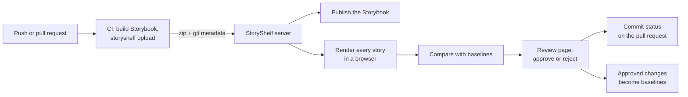

StoryShelf is a server you run. Your CI uploads a built Storybook to it; the server renders every story in a browser, compares each screenshot with an approved baseline, and shows the differences to reviewers. Approving a change updates the baseline and, if you use it, unblocks the pull request.

Nothing leaves your infrastructure unless you configure it to, and nothing is billed per snapshot: the cost is the machines you run it on (see [Sizing and cost](/guides/sizing/)).

## The path of a change

1. **CI uploads.** The CLI builds your Storybook (or reuses a build), zips it and sends it with the commit, branch and author. It needs no browser and does not clone anything: it is a small client, so it installs cleanly in CI. See [CI setup](/guides/ci/).
2. **The server stores and publishes.** The build is saved and the Storybook is published for anyone with access, so designers and product managers can browse it without a checkout. See [Published Storybook](/concepts/publishing/).
3. **The server renders.** A background consumer on the server serves the uploaded build locally and renders each story at each configured viewport, theme and browser. Rendering happens on the server, in a browser the server controls, so the pixels do not depend on whose machine ran CI. See [Capture & viewports](/concepts/capture/).
4. **Screenshots are compared.** Each screenshot is compared with the approved baseline for the same story, viewport and browser. A story with no difference is unchanged; a story over the threshold is changed; a story with no baseline is new. See [Baselines & branches](/concepts/baselines/).
5. **People review.** The build page shows each changed story with a diff overlay. Reviewers approve or reject, and can comment. See [Reviewing changes](/guides/review/).
6. **The pull request is told.** StoryShelf posts a commit status (and, on GitHub, optionally a check run with annotations) that you can require before merging. See [Merge gate](/guides/merge-gate/).

## What runs where

| Where                     | What runs                                                                   | What it needs                                             |
| ------------------------- | --------------------------------------------------------------------------- | --------------------------------------------------------- |
| **Your CI**               | The `storyshelf` CLI: build, zip, upload                                    | Node.js and a project token. No browser.                  |
| **The StoryShelf server** | The web UI and API, the capture consumer, the browser that renders, diffing | A long-running host: a container, VM or Kubernetes pod.   |
| **A database**            | Projects, builds, snapshots, users, comments, the job queue                 | SQLite (the default), Postgres or MySQL                   |
| **Storage**               | Screenshots, diff overlays, uploaded Storybook builds                       | The local disk (the default), S3-compatible, Azure or GCS |
| **Reviewers' browsers**   | The server-rendered review UI                                               | Nothing to install                                        |

There is one server process to run. The job queue lives in your database (`capture_jobs`), so there is no separate queue, worker or cache service. Pick the database and storage that match your infrastructure: they are interchangeable adapters, and moving from SQLite and local disk to Postgres and S3 later does not change how you use StoryShelf. See the [Packages](/packages/) list and [Deployment](/guides/deployment/).

## Baselines in one paragraph

Each branch has its own baselines, falling back to the default branch's. A brand-new story on the default branch is approved automatically and becomes a baseline; on a feature branch it is marked new and waits for review. When a reviewer accepts a change on a feature branch, that branch's baseline moves, so the next commit is compared with what was accepted instead of flagging the same change again. Baselines are looked up by project, story, viewport, browser and branch, never by walking git history, so rebases, force-pushes and squash merges do not break them. Builds are temporary and purged after a retention window; baselines are kept. See [Baselines & branches](/concepts/baselines/) and [Retention & purge](/concepts/retention/).

## What you can leave out

- **Capture and comparison.** Without the `testing` option, an instance only publishes and shares Storybooks. That is a smaller, cheaper deployment, and it can run on serverless platforms. See [Hosting only](/concepts/hosting-only/).
- **Authentication.** Off by default for a first try; turn on local accounts, social login, OIDC, SAML or passkeys for a shared instance. See [Access](/guides/auth/).
- **Git integration, notifications, design links, AI insights.** Each is optional and configured separately.

## Scope

StoryShelf is for Storybook. It tests the stories you already have, in the browsers the server runs (Chromium by default; Firefox and WebKit on request). It is self-hosted: you run, back up and upgrade it. The [comparison with Chromatic](/guides/chromatic-comparison/) lists what it does not do, among them cloud parallelisation and built-in flake detection.

## Where next

- To try it: [Getting started](/guides/getting-started/), or the [live demo](/guides/demo/).
- To check it is safe to adopt: [Security and data handling](/guides/security/) and [Sizing and cost](/guides/sizing/).
- For common setups: [Common setups](/guides/recipes/). When something goes wrong: [Troubleshooting and FAQ](/guides/troubleshooting/).
