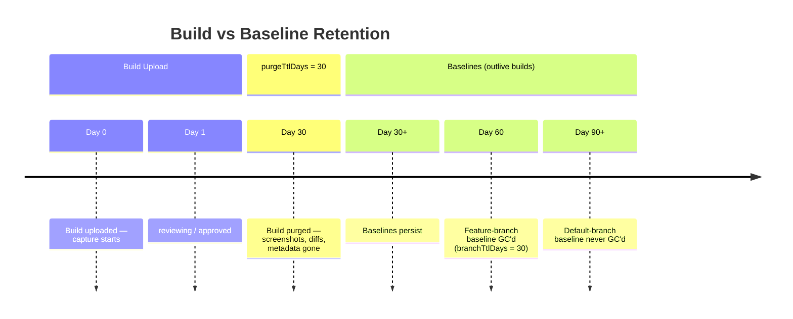

Everything below the **baseline** is transient. Baselines are truth.



## What survives purge

| What                                                           | Retention key                                     | Survives?                                  |
| -------------------------------------------------------------- | ------------------------------------------------- | ------------------------------------------ |
| Build metadata, screenshots, diff overlays                     | `purgeTtlDays` (default 30)                       | No — deleted together in one transaction   |
| Storybook `content/<hash>` (shared, `content_refs` `refCount`) | `content_refs` 7-day grace (`refCount 0` kept 7d) | Yes — shared, refCounted, GC’d after grace |
| Branch baselines (`baselines/{branch}/**`)                     | `branchTtlDays` (default 30, `null` = disabled)   | Until branch GC                            |
| Default-branch baselines (`baselines/main/**`)                 | Never                                             | Yes                                        |
| Builds bearing `persistent` label (git tags → `v1.2.3`)        | Never                                             | Yes, and their snapshots as baselines      |

Retention keeps **the most recent build per branch** even past TTL — it’s the branch’s “current state” and powers label/PR links.

Builds that are being captured or reviewed (`capturing`/`comparing`/`reviewing`) are never purged. A `pending` build is handled by its own rule below.

## Pending builds

A build left `pending` waits for a [review verdict](/guides/review/#review-without-screenshots) (or for its capture to start), so the terminal-status rule never reaches it and it would otherwise accumulate. A `pending` build is purged once its **last activity** is older than `purgeTtlDays`: the later of its upload (last update), its newest comment and its newest verdict. A comment or verdict therefore keeps a build under review alive, and a build that a newer build on the same branch replaced, with no attempts, comments or verdicts, leaves at the same window. "The latest build per branch" does not shield a pending build: a branch that nobody reviews stops holding one after the window. Persistent builds are never purged. Purging a build removes its comments and verdicts with it.

Turning a project's review off accepts its pending builds that no capture worked on, in one pass when the setting is saved (see [Project settings](/guides/project-settings/#review)).

## Orphan & branch GC

- **Orphaned baselines:** a story renamed/removed from Storybook never gets a natural diff. On each default-branch build, StoryShelf diffs `index.json` against `baselines` and deletes baselines whose `story_id` no longer exists.
- **Stale branches:** a daily sweep (`branchGcIntervalMs` 24h, staggered 1h) deletes `baselines/{branch}/**` files and rows for branches whose latest build is older than `branchTtlDays`. Default branch never GC’d.

## Triggers

- **Scheduled:** in-server timers (hourly build purge + daily branch GC).
- **Manual:** `storyshelf purge --url $SHELF_URL --token $STORYSHELF_ADMIN_TOKEN` or `POST /api/v1/admin/purge` (admin) — runs both sweeps and returns `{ removedBuilds, removedBranches, removedBaselines }`.

Configure via `ShelfConfig` or env:

```ts
createShelfApp({
  config: {
    purgeTtlDays: 30,
    branchTtlDays: 30, // null to disable branch GC
    branchGcIntervalMs: 86_400_000,
    purgeIntervalMinutes: 60,
  },
});
```

Uploads ≤ `maxInlineUnzipSize` (default 50 MB) are extracted inline so the published Storybook is live immediately; larger ones are published by a background `publish` job (see [Published Storybook](/concepts/publishing/)).

## Related

- [Baselines & branches](/concepts/baselines/) — which screenshot is expected
- [Builds & snapshots](/concepts/builds/) — build lifecycle
- [Review](/guides/review/) — comments, verdicts and what happens to builds nobody finishes
- [Labels](/concepts/labels/) — `persistent` label from git tags
- [Deployment — retention notes](/guides/deployment/) — `public_branch_regex` publishing
