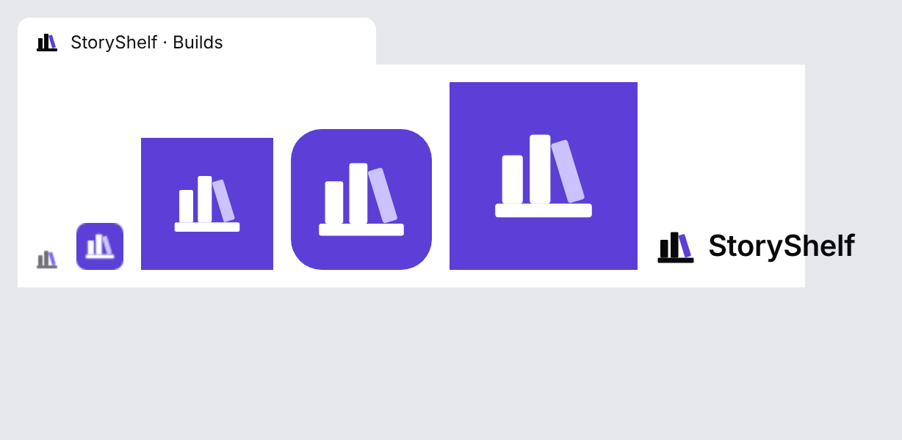
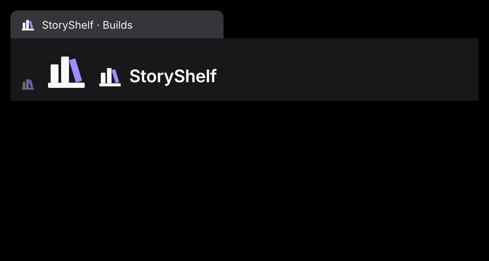

# Brand and voice

How StoryShelf looks and sounds. Issue #947 set the mark; #946 set the violet accent.

## The mark

One shelf with three books of different heights; the last book leans on its neighbour. The leaning
book is the changed one, so the mark says "diff", not only "library". It is original: no letterform,
no container at small sizes, nothing borrowed from another product.

- **Colour.** Only the leaning book carries the accent. Everything else is the neutral text colour
  (`#09090b` light, `#fafafa` dark), or white on the accent tile, where the leaning book is a pale
  accent (`#cbc2ff`) so it still reads as the changed one.
- **Accent.** `#5b3fd6` on light, `#9d8cff` on dark: the app's `accent` tokens
  (`packages/core/src/brand-packs.ts`).
- **16 px.** The bare mark on a 16-unit grid with whole-pixel books, no tile. `favicon.svg` follows
  the browser's colour scheme. The PNG fallbacks cannot, so `favicon-16.png` uses mid-tones
  (`#71717a`, `#7c66f0`) that read on light and dark tabs.
- **32 px and up** may use the rounded accent tile. Installable icons use it; the maskable icon is
  full-bleed with the mark inside the 40 % safe circle.
- **Wordmark.** "StoryShelf" in the UI sans (`ui-sans-serif, system-ui, …`) at weight 600, in the
  neutral text colour, after the mark. Never in the accent, never with a gradient.
- **Format.** Hand-written SVG: no embedded fonts, no raster, no editor metadata.

The favicon at 16 px in a light and a dark tab, with the raster fallbacks and the wordmark:

### Files

The sources live in `apps/website/src/assets/brand/`:

| File                                      | Use                                                |
| ----------------------------------------- | -------------------------------------------------- |
| `mark-light.svg`, `mark-dark.svg`         | Bare mark per theme (website header)               |
| `tile.svg` (also `../logo.svg`)           | Mark on the rounded accent tile                    |
| `tile-square.svg`, `maskable.svg`         | Full-bleed tiles (Apple touch icon, maskable icon) |
| `wordmark-light.svg`, `wordmark-dark.svg` | Mark plus wordmark                                 |

`apps/website/public/favicon.svg` is the theme-aware favicon. `nub scripts/brand-icons.mjs` renders
the PNGs and `favicon.ico` from these files and checks the maskable safe zone (`--check` only
checks). `nub scripts/screenshots.mjs og` renders `og-image.png` from the tile, the wordmark and the
tagline. The app embeds the tile (default sidebar logo) and the favicon in
`packages/app/src/assets/mark.ts`; keep them in step with the sources.

Operators still override the name and logo (`ui.name`, `ui.logo`, `SHELF_BRAND_NAME`,
`SHELF_LOGO_URL`) and the colours (brand packs). The favicon is not brandable, so a StoryShelf tab
stays recognisable. Machine names stay lowercase: the git status and check-run names are
`storyshelf/testing`, `storyshelf/review` and `storyshelf/storybook`, because branch protection
matches required checks by exact name.

## Voice

StoryShelf talks like a careful colleague: short, specific, calm.

- **Sentence case** everywhere: headings, buttons, menu items, check titles ("Review open", not
  "Review Open").
- **Plain words.** Say what happened and what to do next: "Capture failed: the Storybook did not
  load", not "An unexpected error occurred". Prefer "approve" to "accept", "build" to "run".
- **Status words match the app**: "Needs review", "Approved", "Rejected", "Failed", "Cancelled",
  "Capturing". Use the same word in the UI, the CLI, git statuses, chat and email.
- **No exclamation marks** in the CLI, and rarely anywhere else. Success is quiet: "Uploaded 42
  stories".
- **The name.** Always "StoryShelf", one word, capital S twice. Never abbreviate it to "SS". The
  short form is "Shelf" (`SHELF_*` variables, "[Shelf]" email subjects, diagrams).
- **Competitors.** Name Chromatic only on the comparison page.
